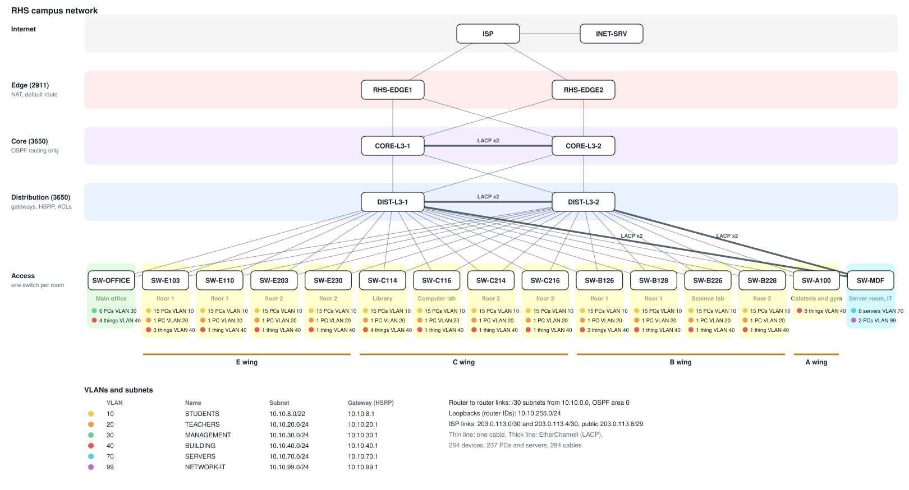
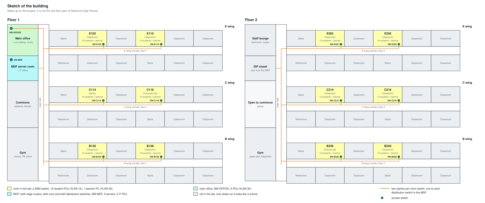

# RHS campus network (proposed design)

Packet Tracer 9.0 project. The file is `RHS School Network.pkt`.

## In one minute

**The problem.** A school has students, teachers, office staff and IT on one network. Students
must not reach staff PCs or the file server, everybody needs the internet, and one broken
switch or cable must not stop classes.

**The design.** Three layers (access, distribution, core) plus two edge routers, with two of
everything above the room switches. Each group of people has its own VLAN and subnet, the rules
between them are ACLs on the distribution switches, and HSRP, Rapid PVST+, EtherChannel and
OSPF move traffic to the other device when one fails.

**Why this way.** VLANs by role (not by room) mean one set of rules for all students wherever
they sit. Putting the gateways and ACLs on the distribution layer keeps the core simple. Two
uplinks per room switch cost one extra cable per room and remove every single point of failure
between a room and the internet: `tools/labtest.py` breaks all 50 backbone devices and cables
one at a time and counts that all 204 PCs and servers still have a path out.



Where it would all be in a building. The sketch is made up (it is not the real RHS floor plan),
the coloured rooms are the ones in the lab:



Other files in this folder:

- `WALKTHROUGH.md` - how to open the lab, log in, and how each part was built step by step
- `configs/` - the config of every router and switch, with comment lines (`! ----`) explaining each part
- `tools/` - Python programs I wrote for the project (no installs needed):
  - `netcheck.py` checks subnets, the addressing plan and the inventory, compares configs and makes a config for a new room switch
  - `netconfig.py` builds configuration changes for groups of devices (all access switches, both distribution switches, ...)
  - `pktconfig.py` writes those changes straight into `RHS School Network.pkt`, so nothing has to be pasted into each device
  - `pktfile.py` unpacks and packs the `.pkt` file format (used by the other two)
  - `pktlayout.py` arranges the devices on the canvas, draws the coloured boxes and writes the text notes in the lab
  - `pktbuild.py` adds a whole classroom (switch, 16 PCs, cables, uplinks, configs) to the lab with one command
  - `labtest.py` runs measurable tests on the lab file (redundancy, VLANs, security, monitoring) and keeps a history of the score
  - `diagram.py` draws `topology.svg` from the cables and configs inside the lab file
  - `floorplan.py` draws `floorplan.svg`, a made up sketch of the building with the rooms of the lab in it
  - `netcheck_ui.py` is a simple page in the browser with buttons for all of it. Start it with `python3 tools/netcheck_ui.py`
- `screenshots/` - screenshots for this document (list is at the bottom)

## 1. Lab overview

This is my own design for part of a high school network, using twelve rooms in three wings
(E, C and B) on two floors, named after rooms at Redmond High School. A room number is wing,
floor, room: E230 is wing E, floor 2. Three of them have a job: C114 is the library, C116 a
computer lab and B226 a science lab. It is NOT the real RHS network. I don't know
how the district set theirs up, so the topology, subnets, VLANs and rules are my own choices.

What the network has to do:

- 180 student PCs (15 per room), 12 teacher PCs, 6 office PCs, 2 IT PCs, 4 servers
- students, teachers, office staff and IT are kept apart, with rules for who can reach what
- every PC gets its address from one DHCP server
- everyone reaches the internet through NAT
- no single switch, router or cable between a room and the internet can take the school down

Everything uses CCNA level commands only: VLANs, trunks, EtherChannel (LACP), Rapid PVST+,
HSRP, OSPF single area, DHCP relay, standard and extended ACLs, NAT/PAT, port security,
DHCP snooping, SSH, syslog, NTP.

Logins (same on every router and switch, console included):

    username:       admin
    password:       RHSadmin
    enable secret:  RHSenable

## 2. Topology

Three layers, like the Cisco campus model. The picture at the top of this page (`topology.svg`)
is drawn by `tools/diagram.py` from the lab file itself. The same thing as text:

```
                         INET-SRV
                            |
                          [ISP]
                         /     \
                [RHS-EDGE1]   [RHS-EDGE2]        EDGE: NAT, internet ACL
                    |     \   /     |
                [CORE-L3-1]=====[CORE-L3-2]      CORE: routing only (OSPF)
                    |     \   /     |
                [DIST-L3-1]=====[DIST-L3-2]      DISTRIBUTION: gateways, HSRP, ACLs, DHCP relay
                  |  |  |  |  |  |  |  |  |  |
   SW-OFFICE     E wing (4)      C wing (4)      B wing (4)      SW-MDF          ACCESS
    6 PCs      one 2960 per room, 16 PCs each (15 students + teacher)   4 servers, 2 IT PCs
```

`=====` is an EtherChannel. Every access switch has one trunk to DIST-L3-1 and one to DIST-L3-2.

| Device | Model | Layer | Job |
|--------|-------|-------|-----|
| RHS-EDGE1, RHS-EDGE2 | 2911 | edge | NAT, default route to the ISP, ACL for traffic from the internet |
| CORE-L3-1, CORE-L3-2 | 3650 | core | route between edge and distribution, nothing else |
| DIST-L3-1, DIST-L3-2 | 3650 | distribution | default gateway of every VLAN (HSRP), ACLs between VLANs, DHCP relay, STP root |
| SW-E103, SW-E110, SW-E203, SW-E230, SW-C114, SW-C116, SW-C214, SW-C216, SW-B126, SW-B128, SW-B226, SW-B228 | 2960 | access | one per room. Fa0/1-15 students, Fa0/16 teacher, Gi0/1 and Gi0/2 uplinks |
| SW-OFFICE | 3650 as layer 2 | access | main office and counseling |
| SW-MDF | 3650 as layer 2 | access | servers and the IT office |
| ISP, INET-SRV | 2911, server | outside | pretend internet |

### Why three layers

My first version had the cores doing everything (routing, gateways, ACLs) with all eight access
switches plugged into them. It worked on paper but it was hard to read, and every job was on
the same two boxes. Splitting it up:

- the core only has routed links, so there is nothing there for spanning tree to block and
  nothing to filter. If more buildings were added they would each get their own distribution
  pair and plug into the same core
- all the VLAN rules are in one place (distribution), so there is one place to look when
  something is blocked
- access switches stay simple layer 2 switches that are all configured the same way

## 3. VLANs

| VLAN | Name | Subnet | Gateway | Who | Root / HSRP active |
|------|------|--------|---------|-----|--------------------|
| 10 | STUDENTS | 10.10.8.0/22 | 10.10.8.1 | the 180 room PCs | DIST-L3-1 |
| 20 | TEACHERS | 10.10.20.0/24 | 10.10.20.1 | teacher PC in each room | DIST-L3-2 |
| 30 | MANAGEMENT | 10.10.30.0/24 | 10.10.30.1 | principal, counselors, office | DIST-L3-2 |
| 70 | SERVERS | 10.10.70.0/24 | 10.10.70.1 | servers | DIST-L3-1 |
| 99 | NETWORK-IT | 10.10.99.0/24 | 10.10.99.1 | IT PCs and switch management | DIST-L3-1 |
| 100 | CORE-TRANSIT | 10.10.0.8/30 | | between the two cores | |
| 101 | DIST-TRANSIT | 10.10.0.36/30 | | between the two distribution switches | |
| 998 | PARKING | | | unused ports, shut down | |
| 999 | NATIVE | | | native VLAN on trunks, nothing in it | |

Why:

- **One VLAN per kind of user, not per room.** The rules are about who you are (student,
  teacher, office, IT), not where you sit. A student in E230 and one in C214 get the same rules.
- **Students get a /22** (1022 addresses) because it is the biggest group and would grow first.
  The others are /24 because that is easy to read and far more than they need.
- **VLAN 1 is not used** for anything, and the native VLAN is an empty VLAN (999). That way
  untagged frames on a trunk end up nowhere.
- **Unused ports are in VLAN 998 and shut down**, so plugging into a spare port does nothing.
- **Trunks only carry what the switch needs**: room switches 10,20,99. SW-OFFICE 30,99.
  SW-MDF 70,99. A student VLAN broadcast never reaches the office switch.

## 4. IP addressing

Gateways: the HSRP address is always .1, DIST-L3-1 is .2 and DIST-L3-2 is .3 in each VLAN.

Servers and static hosts:

    SRV-DHCP      10.10.70.5    DHCP for students, teachers and management
    SRV-DNS-WEB   10.10.70.10   DNS and the school web page (www.rhs.lab)
    SRV-LOG       10.10.70.20   syslog and NTP
    SRV-FILE      10.10.70.30   FTP file server for staff (admin / RHSadmin)
    IT-PC1        10.10.99.50
    IT-PC2        10.10.99.51

DHCP scopes on SRV-DHCP (every other PC uses DHCP):

    STUDENTS     10.10.8.50  - 10.10.10.37    gateway 10.10.8.1    DNS 10.10.70.10
    TEACHERS     10.10.20.50 - 10.10.20.149   gateway 10.10.20.1   DNS 10.10.70.10
    MANAGEMENT   10.10.30.50 - 10.10.30.149   gateway 10.10.30.1   DNS 10.10.70.10

Switch management (VLAN 99): room switches 10.10.99.11 to .20 and .23, .24 in the order they
were added (E230, E110, E103, E203, C214, B126, B128, C216, C114, C116, B226, B228), the full
list is in `tools/inventory.csv`. SW-OFFICE .21, SW-MDF .22.

Point to point links (all /30):

    RHS-EDGE1 - CORE-L3-1   10.10.0.0     (edge .1, core .2)
    RHS-EDGE1 - CORE-L3-2   10.10.0.4     (edge .5, core .6)
    CORE-L3-1 - CORE-L3-2   10.10.0.8     (VLAN 100, .9 and .10)
    RHS-EDGE2 - CORE-L3-1   10.10.0.12    (edge .13, core .14)
    RHS-EDGE2 - CORE-L3-2   10.10.0.16    (edge .17, core .18)
    CORE-L3-1 - DIST-L3-1   10.10.0.20    (core .21, dist .22)
    CORE-L3-1 - DIST-L3-2   10.10.0.24    (core .25, dist .26)
    CORE-L3-2 - DIST-L3-1   10.10.0.28    (core .29, dist .30)
    CORE-L3-2 - DIST-L3-2   10.10.0.32    (core .33, dist .34)
    DIST-L3-1 - DIST-L3-2   10.10.0.36    (VLAN 101, .37 and .38)

    Loopbacks   EDGE1 10.10.255.1, CORE-L3-1 .2, CORE-L3-2 .3, EDGE2 .4, DIST-L3-1 .5, DIST-L3-2 .6

Outside:

    ISP - RHS-EDGE1    203.0.113.0/30   (ISP .1, EDGE1 .2)
    ISP - RHS-EDGE2    203.0.113.4/30   (ISP .5, EDGE2 .6)
    Public block       203.0.113.8/29   the web server is NATed to 203.0.113.10
    ISP - INET-SRV     198.51.100.0/24  (server is .10, it answers as www.example.com)
    ISP Lo0            8.8.8.8

Why:

- **Everything inside is in 10.10.0.0/16**, so one line covers the whole school in the NAT
  ACL and in OSPF, and the third number tells you what it is (8 = students, 20 = teachers,
  70 = servers, 99 = IT, 0 = links between routers, 255 = loopbacks).
- **/30 on router to router links** because there are only ever two addresses on them.
- **Servers and network gear are static, PCs are DHCP.** Things other devices point at must
  not change address. 100 PCs by hand would be slow and I would make typos.
- **One DHCP server instead of a pool on each switch**, so there is one place to look at
  leases. It costs one extra command (`ip helper-address`) on each gateway.
- The outside addresses are from the documentation ranges (203.0.113.0/24, 198.51.100.0/24)
  so they are not somebody's real addresses. 8.8.8.8 is just an easy ping target.
- I first wrote the student subnet as 10.10.10.0/22, which is wrong: a /22 has to start on a
  multiple of 4 in the third number, so the real subnet is 10.10.8.0/22. `netcheck.py subnet`
  catches this.

IPv6 is only on the links between routers, the server VLAN and the IT VLAN, with static routes.
I left it off the student, teacher and management VLANs on purpose: the ACLs are IPv4 only, so
IPv6 there would be a way around them.

## 5. Routing

- **OSPF process 1, single area 0** on the two edge routers, two cores and two distribution
  switches. `network 10.10.0.0 0.0.255.255 area 0` on the switches.
- `passive-interface default` on the cores and distribution switches, then `no passive-interface`
  only on the links to other routers. The VLAN subnets are advertised but no hellos go out
  toward PCs.
- Each edge router has a static default route to the ISP and gives it to everyone else with
  `default-information originate`. EDGE2 adds `metric 100` so it is only used if EDGE1's
  default goes away.
- Hello 2 / dead 8 on the router to router links so a failure is noticed in 8 seconds
  instead of 40.
- Loopback 0 on each device is the router ID, so the ID does not change when a port goes down.
- The ISP has static routes for the public block, with a floating static (AD 5) through EDGE2.
- NAT on both edge routers: PAT (`overload`) for 10.10.0.0/16, and a static NAT so the school
  website 10.10.70.10 is reachable from outside as 203.0.113.10.

Why OSPF instead of static routes: with two edges, two cores and two distribution switches
there are several paths to everything. Static routes would need a floating backup for every
path. OSPF works the paths out and moves traffic when a link dies. Single area because six
routers is far too few to need more.

Inter-VLAN routing is done on the distribution switches with SVIs (`interface vlan`), not
router on a stick, because a layer 3 switch routes at switch speed and does not push every
VLAN down one router link.

## 6. ACLs

| From | To | Result |
|------|----|--------|
| Students | internet, DNS, school web page | allow |
| Students | teachers, management, IT, file server, other servers | deny |
| Teachers | servers (web, files), students, internet | allow |
| Teachers | management, IT | deny |
| Management | servers, teachers, students, internet | allow |
| Management | IT | deny |
| Network IT | everything | allow |
| Servers | may answer, may not start a connection into the school | |
| Internet | school web server on 80/443 only | allow |
| Anyone except IT | SSH to a router or switch | deny |

Where they are:

| ACL | Type | Applied | On |
|-----|------|---------|----|
| STUDENTS-IN | extended, named | `ip access-group ... in` on interface Vlan10 | both distribution switches |
| TEACHERS-IN | extended, named | in on Vlan20 | both distribution switches |
| MANAGEMENT-IN | extended, named | in on Vlan30 | both distribution switches |
| SERVERS-IN | extended, named | in on Vlan70 | both distribution switches |
| OUTSIDE-IN | extended, named | in on the WAN port | both edge routers |
| 10 | standard | `access-class 10 in` on the vty lines | every router and switch |
| 1 | standard | used by NAT | both edge routers |

Why:

- **Extended ACLs go close to the source**, so they are inbound on the VLAN's own gateway.
  The packet is dropped before it gets routed anywhere.
- **Named ACLs** because `STUDENTS-IN` in a config explains itself and 101 does not.
- **The same ACL is on both distribution switches.** Either one can be the gateway after a
  failure, so both need the rules.
- **DHCP is permitted first** in every user ACL. Without that line a PC cannot get an address
  and nothing else matters.
- These ACLs are not stateful, so replies have to be allowed by hand. That is what
  `permit tcp ... established` and `permit icmp ... echo-reply` are for. Example: IT can ping a
  student PC because the student ACL lets the echo-reply go back to 10.10.99.0/24, but a
  student cannot start a ping to IT.
- Students are blocked from all of 10.0.0.0/8 after the few allowed lines, then `permit ip any
  any` lets them out to the internet. It is shorter than listing each VLAN and still covers
  VLANs added later.
- `access-class 10` only lets the IT VLAN SSH in. Telnet is off (`transport input ssh`).

The full ACLs are at the end of `configs/DIST-L3-1.txt` and `configs/RHS-EDGE1.txt`.

## 7. Redundancy

| If this fails | What takes over | How |
|---------------|-----------------|-----|
| ISP link 1 or RHS-EDGE1 | RHS-EDGE2 | OSPF default route with a worse metric becomes the only one |
| One edge to core link | the edge router's other link | OSPF |
| A core switch | the other core | each distribution switch has a routed link to both |
| A distribution switch | the other one | HSRP moves the .1 gateway, STP unblocks the other uplink |
| An uplink from a room switch | its other uplink | Rapid PVST+ |
| One cable between the cores, the distribution pair, or to SW-MDF | the other cable in the bundle | LACP EtherChannel |

Why:

- **HSRP** gives the PCs one gateway address (.1) that does not care which switch is alive.
  The active switch for a VLAN is also that VLAN's STP root, so traffic goes straight up the
  forwarding uplink instead of across to the other switch and back.
- **The load is split**: DIST-L3-1 is active for VLAN 10, 70, 99 and DIST-L3-2 for 20 and 30.
  Both uplinks of a room switch carry traffic, instead of one sitting idle.
- **EtherChannel only where it is worth it.** My earlier version had a 2 link bundle from every
  access switch to both cores. That was 32 uplink cables and the diagram was unreadable. A room
  of 16 PCs does not need 2 Gbps to each side, and it already has two uplinks for failover. I
  kept bundles in three places: between the cores, between the distribution switches (all
  traffic that has to cross sides uses these) and from SW-MDF (every PC talks to the servers).
- **LACP (`mode active`) instead of `mode on`**, so a bundle only forms if the other end agrees.
- The room switches now use both gigabit ports as uplinks (Gi0/1 and Gi0/2), one to each
  distribution switch.

Still single points of failure: the ISP itself, each server, and each room switch (if SW-E230
dies, room E230 is down, which is normal for an access switch).

## 8. Security and management

- portfast, BPDU guard and sticky port security (max 2 MACs, violation restrict) on PC ports
- DHCP snooping on the room switches and SW-OFFICE, uplinks trusted, rate limit on PC ports
- `switchport nonegotiate` on trunks, so a PC cannot talk a port into trunking
- SSH version 2 only, local usernames, `service password-encryption`, enable secret, login banner
- syslog and NTP to SRV-LOG, SNMP read only, LLDP

SSH needs keys that cannot be saved in the file: on each device run `crypto key generate rsa`
and answer 1024.

## 9. Tests

Wait about a minute after opening the file. If a PC has no address, switch its IP setting to
Static and back to DHCP once.

I have not filled in the Result column yet. It gets filled in from real output only.

| # | Test | Expected | Result |
|---|------|----------|--------|
| 1 | E230-PC01 `ipconfig` | 10.10.8.50 - 10.10.10.37, gateway 10.10.8.1, DNS 10.10.70.10 | |
| 2 | E230-TCHR `ipconfig`, PRINCIPAL-PC `ipconfig` | 10.10.20.x and 10.10.30.x | |
| 3 | SW-E230 `show vlan brief`, `show interfaces trunk` | Fa0/1-15 in 10, Fa0/16 in 20, trunks Gi0/1 and Gi0/2 | |
| 4 | SW-E230 `show spanning-tree vlan 10` and `vlan 20` | Gi0/1 forwarding for 10, Gi0/2 forwarding for 20 | |
| 5 | DIST-L3-1 `show standby brief` | Active for 10, 70, 99. Standby for 20, 30 | |
| 6 | DIST-L3-1 `show etherchannel summary` | Po1 and Po2 with (P) on the member ports | |
| 7 | CORE-L3-1 `show ip ospf neighbor` | 5 neighbors, all FULL | |
| 8 | DIST-L3-1 `show ip route` | default route `O*E2` learned from RHS-EDGE1 | |
| 9 | E230-PC01 ping C214-PC01 | works (same VLAN, different room) | |
| 10 | E230-PC01 ping a teacher or office PC | fails | |
| 11 | E230-PC01 browser to www.rhs.lab, then ftp 10.10.70.30 | web page loads, ftp fails | |
| 12 | E230-PC01 ping 8.8.8.8 | works | |
| 13 | E230-TCHR ping 10.10.70.10, ftp 10.10.70.30, ping an office PC | works, works, fails | |
| 14 | PRINCIPAL-PC ping 10.10.70.10, ping 10.10.99.50 | works, fails | |
| 15 | IT-PC1 ping a PC in every VLAN, `ssh -l admin 10.10.99.11` | all work (SSH after keys) | |
| 16 | E230-PC01 `ssh -l admin 10.10.99.11` | refused | |
| 17 | Browser to www.example.com, then RHS-EDGE1 `show ip nat translations` | page loads, translations listed | |
| 18 | INET-SRV browser to 203.0.113.10, ping 10.10.70.10 | school page loads, ping fails | |
| 19 | Shut and no shut a port, look at Syslog on SRV-LOG | messages arrive | |

Failure tests (start `ping -t 8.8.8.8` on E230-PC01 first, undo each one after):

Write down how many pings were lost in each one. That number is the measurement. A few lost
pings while the other device takes over are expected, a ping that never comes back is a fail.

| # | Break this | Expected | Pings lost | Result |
|---|------------|----------|------------|--------|
| F1 | `shutdown` G0/0/0 on RHS-EDGE1 | a few pings lost, default route moves to RHS-EDGE2 | | |
| F2 | `shutdown` Gi1/0/1 and Gi1/0/4 on DIST-L3-1 (both uplinks) | traffic goes through DIST-L3-2 over VLAN 101 | | |
| F3 | `shutdown` interface Vlan10 on DIST-L3-1 | DIST-L3-2 becomes HSRP active for VLAN 10 | | |
| F4 | `shutdown` Gi0/1 on SW-E230 | Gi0/2 goes to forwarding for VLAN 10 | | |
| F5 | `shutdown` Gi1/0/2 on DIST-L3-1 | Po1 stays up on Gi1/0/3 | | |
| F6 | `shutdown` Gi1/0/5 and Gi1/0/6 on CORE-L3-1 | everything goes through CORE-L3-2 | | |

### Measured tests without Packet Tracer

`tools/labtest.py` reads the cables and configs inside the `.pkt` file and measures 14 things.
Every test is a number against a target, so it either passes or it does not. This is the real
output for the lab as it is in this folder:

```
Redundancy
  PASS  Hosts that still reach the ISP after any single failure              204 of 204 hosts
  PASS  Access switches cabled to both distribution switches                 14 of 14 switches
  PASS  VLANs with the same HSRP gateway on both distribution switches       5 of 5 VLANs
  PASS  VLANs where the spanning tree root is also the HSRP active switch    5 of 5 VLANs

Switching
  PASS  Trunk cables with the same allowed and native VLANs on both ends     34 of 34 trunks
  PASS  PCs and servers plugged into a port of the right VLAN                204 of 204 hosts
  PASS  Gateway interfaces that relay DHCP to SRV-DHCP                       6 of 6 interfaces
  PASS  Fullest subnet (lower is better)                                     18 <= 50 % used

Security
  PASS  PC ports with port security                                          200 of 200 ports
  PASS  Host ports with PortFast and BPDU guard                              204 of 204 ports
  PASS  Ports without a cable that are shut down                             200 of 200 ports
  PASS  Devices that only allow SSH version 2 for remote login               20 of 20 devices

Monitoring
  PASS  Devices that send logs to SRV-LOG, use NTP and answer SNMP           20 of 20 devices
  PASS  Device configs in the lab that match the configs folder              21 of 21 devices

14 of 14 tests passed, score 100%.
Lab: 230 devices (20 routers and switches, 204 PCs and servers), 249 cables. 50 single failures tried.
```

`python3 labtest.py --record` adds the result to `changes/health.csv`, so there is a history of
the score after every change (the Monitor tab of the page shows it as a graph). It cannot see
live things like a ping or a DHCP lease. Those are the tables above.

### Troubleshooting examples

Two faults put into a copy of the lab on purpose, how each one was found and how it is fixed.
The `labtest.py` output is real. The Packet Tracer side (symptom and screenshots) I still have
to do myself in the lab.

**Fault 1: a student port in the teacher VLAN.** On SW-E230:

    interface FastEthernet0/3
     switchport access vlan 20

- Symptom to look for in Packet Tracer: E230-PC03 gets a 10.10.20.x address after
  `ipconfig /renew` and can suddenly reach the file server, which students must not
- Found by: `labtest.py` drops from 14 to 12 passing tests and names the port

      FAIL PCs and servers plugged into a port of the right VLAN   203 of 204 hosts
           E230-PC03: on SW-E230 FastEthernet0/3 in VLAN 20, should be VLAN 10
      FAIL Device configs in the lab that match the configs folder  20 of 21 devices
           SW-E230: lab and configs/SW-E230.txt differ

  In the CLI the same thing shows in `show vlan brief` on SW-E230 (Fa0/3 listed under VLAN 20)
- Fix: `interface fa0/3` then `switchport access vlan 10`, renew the address on the PC

**Fault 2: a VLAN missing on one end of a trunk.** On DIST-L3-1:

    interface GigabitEthernet1/0/6
     switchport trunk allowed vlan remove 20

- Symptom to look for: probably none at first. The teacher PC in E110 should keep working
  through the other uplink to DIST-L3-2, so the fault hides until that uplink fails too.
  This is the kind of problem redundancy covers up
- Found by: `labtest.py` compares both ends of every trunk cable

      FAIL Trunk cables with the same allowed and native VLANs on both ends   33 of 34 trunks
           SW-E110 GigabitEthernet0/1 - DIST-L3-1 GigabitEthernet1/0/6: allowed 10,20,99 / 10,99, native 999 / 999

  In the CLI: `show interfaces trunk` on DIST-L3-1 and on SW-E110, compare the "VLANs allowed" lines
- Fix: `interface gi1/0/6` then `switchport trunk allowed vlan add 20`

Both faults can be put in from the Configure tab ("custom commands") and taken out again with
Restore on the History tab.

### Troubleshooting order

When something does not work I go from the bottom up:

1. **Link**: is the triangle green? `show interfaces status`, `show ip interface brief`
2. **VLAN**: is the port in the right VLAN and is the VLAN on the trunk? `show vlan brief`, `show interfaces trunk`
3. **Address**: does the PC have an IP and the right gateway? `ipconfig`. If not: `show ip dhcp snooping binding`, check `ip helper-address`, check the DHCP ACL line
4. **Gateway**: can the PC ping .1? `show standby brief`
5. **Routing**: `show ip route`, `show ip ospf neighbor`
6. **ACL**: `show access-lists` shows a match counter on every line, so you can see which line dropped it
7. **NAT**: `show ip nat translations`

## 10. Things I am not sure about yet

- nothing above has been tested in Packet Tracer yet, the Result columns are empty
- DHCP through the relay for three scopes, DHCP snooping and `default-information originate
  metric 100` are the parts I expect to need fixing first
- no wireless, no guest network, no DAI
- `pktconfig.py` and `pktlayout.py` change the `.pkt` file directly. The file they write unpacks again
  and matches the `configs` folder, but it still has to be opened in Packet Tracer to see that every
  device comes up with the new config. A copy from before each change is in `changes/backups`

## 11. Screenshots to take

Not taken yet. They go in `screenshots/` with these names.

| File | What |
|------|------|
| 01-topology.png | the whole logical view |
| 02-dhcp-student.png | `ipconfig` on E230-PC01 |
| 03-vlan-trunk.png | `show vlan brief` and `show interfaces trunk` on SW-E230 |
| 04-hsrp.png | `show standby brief` on DIST-L3-1 |
| 05-etherchannel.png | `show etherchannel summary` on DIST-L3-1 |
| 06-ospf.png | `show ip ospf neighbor` and `show ip route` on CORE-L3-1 |
| 07-acl-student-blocked.png | E230-PC01 failing to ping an office PC, and `show access-lists` on DIST-L3-1 |
| 08-nat.png | `show ip nat translations` on RHS-EDGE1 |
| 09-failover.png | the ping during failure test F1 |
| 10-netcheck.png | `netcheck.py` output in Terminal |
| 11-routing-table.png | `show ip route` on DIST-L3-1 and RHS-EDGE1 |
| 12-fault1-wrong-vlan.png | troubleshooting fault 1: `show vlan brief` on SW-E230 before and after the fix |
| 13-fault2-trunk.png | troubleshooting fault 2: `show interfaces trunk` on DIST-L3-1 and SW-E110 |
| 14-monitor.png | the Monitor tab of the NetCheck page |
